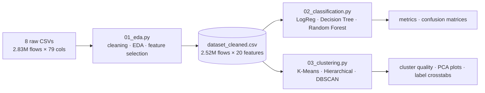
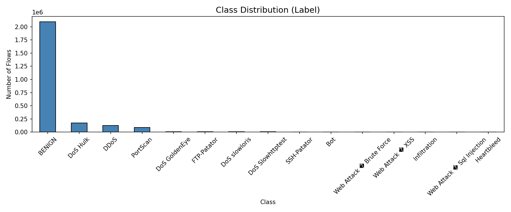
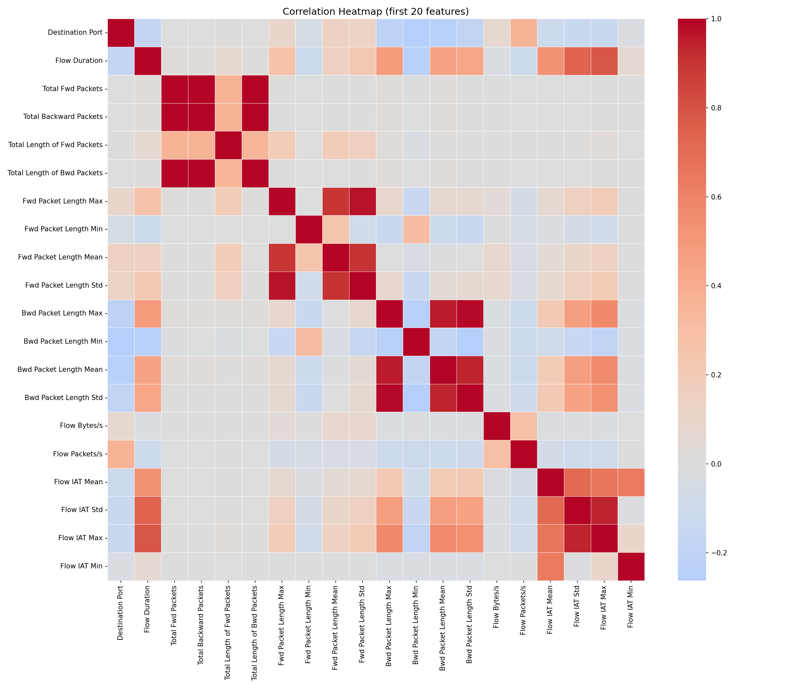
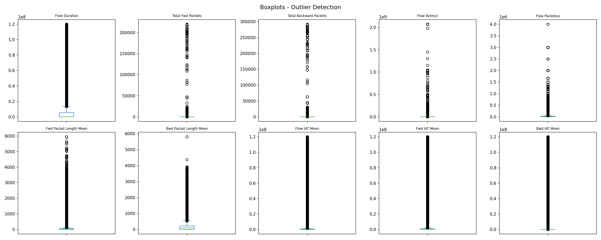
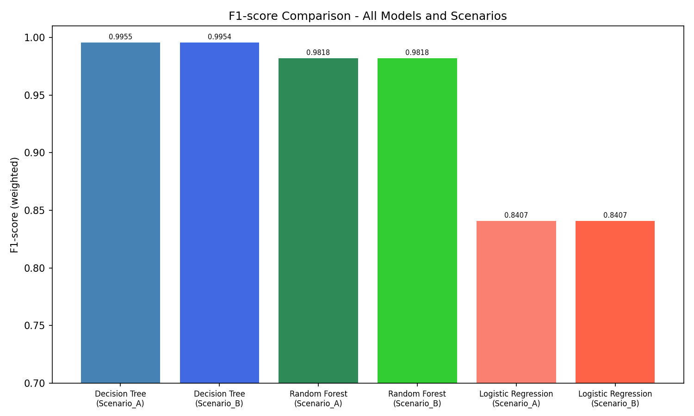
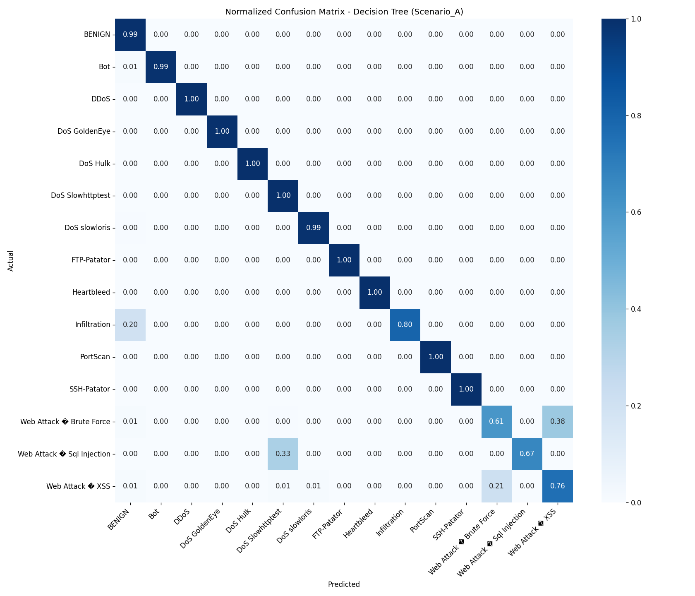
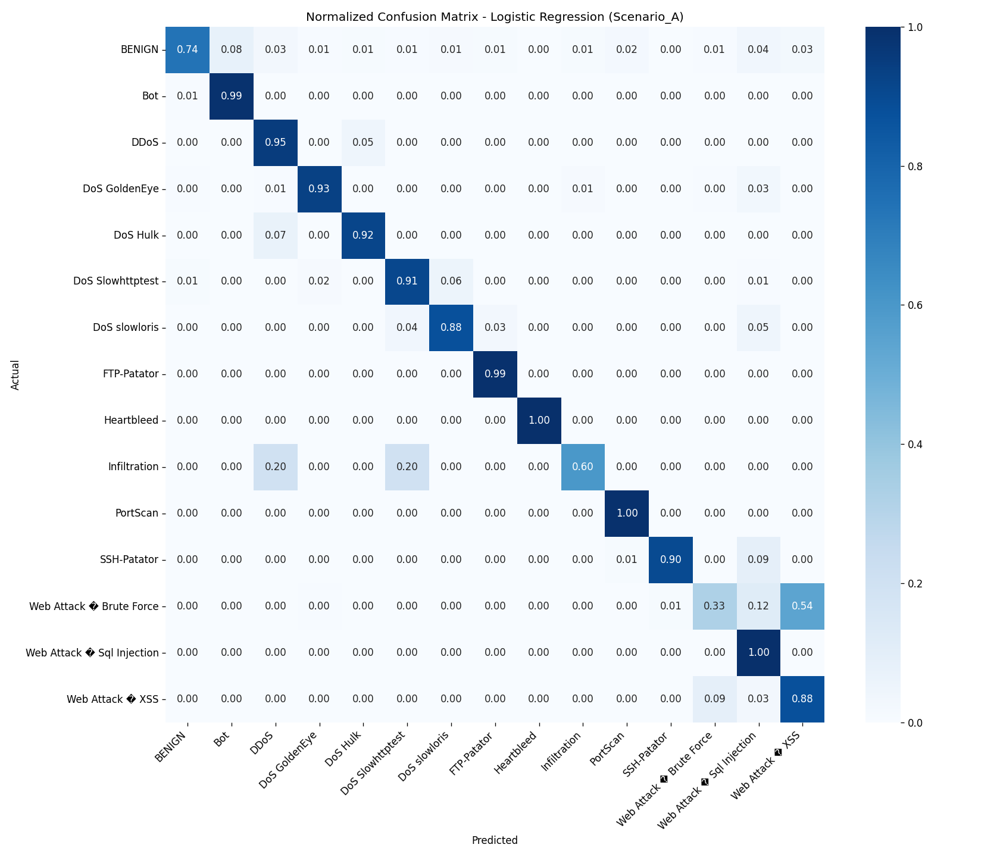
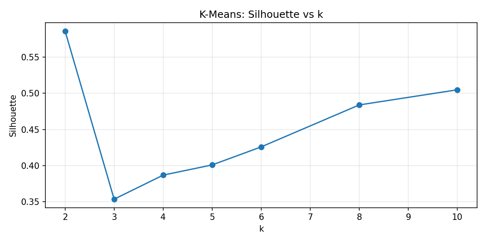
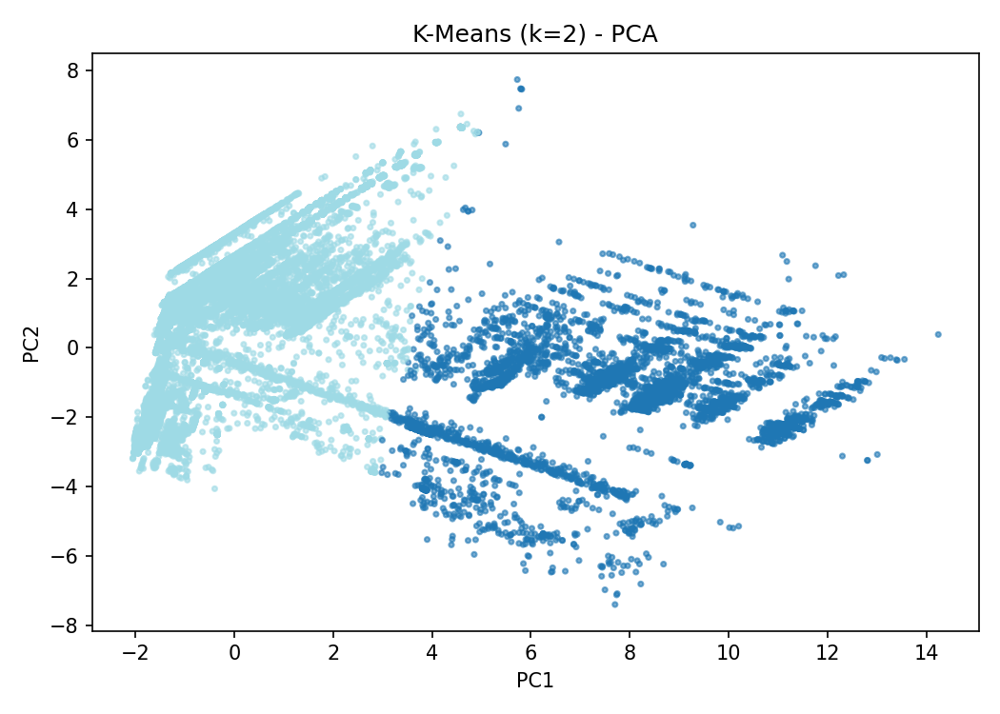
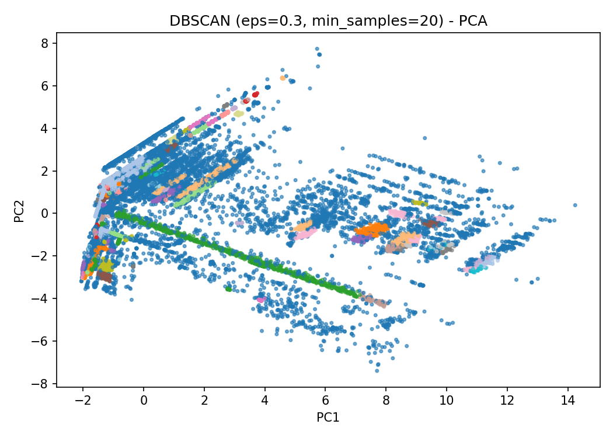

# Network Intrusion Detection on CIC-IDS2017

An end-to-end data mining pipeline that analyses **2.8 million network flows** from the
[CIC-IDS2017](https://www.unb.ca/cic/datasets/ids-2017.html) intrusion detection dataset,
cuts the feature space from 79 to 20 columns, and detects 14 kinds of cyber attack with
supervised classifiers. Unsupervised clustering is then used to see how much of that
attack structure can be found without labels.

**Highlights**

- Cleans 2,830,743 raw flows down to **2,520,657**. It removes NaN/inf values, 307k duplicate rows
  and 141 rows with integer-overflow artifacts.
- Reduces **79 → 20 features** using correlation and variance filtering.
- A tuned **Decision Tree reaches 0.9955 weighted F1** on a held-out test set of ~378k flows,
  across 15 heavily imbalanced classes (BENIGN = 83%, Heartbleed = 11 samples).
- Compares two ways of tuning hyperparameters: a **validation split** and **k-fold cross-validation**.
- Benchmarks K-Means, Agglomerative Clustering and DBSCAN with Silhouette and Davies–Bouldin
  scores, then checks the clusters against the true labels.

---

## Pipeline



| Script | What it does |
|---|---|
| [`01_eda.py`](01_eda.py) | Merges the daily capture files and checks structure, dtypes, missing, infinite and duplicate values. It profiles class imbalance, writes summary statistics, boxplots and a correlation heatmap, then selects features. |
| [`02_classification.py`](02_classification.py) | Stratified 70/15/15 train/val/test split and train-only scaling. It handles class imbalance with `class_weight="balanced"` and grid-searches each model two ways (validation set vs. 3-fold CV). Evaluates with accuracy, precision, recall, F1 and normalized confusion matrices. |
| [`03_clustering.py`](03_clustering.py) | Standardizes the features and samples 50k flows. Sweeps k for K-Means, linkage × k for Agglomerative Clustering, and eps × min_samples for DBSCAN, scoring each with Silhouette and Davies–Bouldin. Projects the best models with PCA and cross-tabulates clusters against true labels. |

---

## 1. Data Cleaning & Exploratory Analysis

| Step | Rows remaining |
|---|---:|
| Raw (8 CSVs merged) | 2,830,743 |
| Drop rows with missing `Flow Bytes/s` (1,358) | 2,829,385 |
| Drop rows with ±inf values (division-by-zero in rate features) | 2,827,876 |
| Drop exact duplicates (307,078) | 2,520,798 |
| Drop integer-overflow artifacts (values < −1000, e.g. −3.2×10⁹) | **2,520,657** |

**Class imbalance.** BENIGN traffic makes up 83.1% of flows. The rarest attacks have only a
handful of samples: Infiltration (36), SQL Injection (21), Heartbleed (11).



**Feature selection.** Columns were dropped for three reasons:

- **Redundancy:** |r| > 0.95 with another feature. For example, `Total Fwd Packets` tracks
  `Subflow Fwd Packets`, and `Fwd Header Length` is duplicated as `Fwd Header Length.1`.
- **Near-zero variance:** variance < 0.01 after Min-Max scaling. This includes the
  `Bulk Rate` family, which is zero for almost every flow.
- **Non-numeric:** any non-numeric column other than `Label`.

The result is 20 features plus the label.

| Correlation structure | Outliers |
|---|---|
|  |  |

---

## 2. Attack Classification

Models were trained on 70% of the data. Hyperparameters were picked either on a separate 15%
validation set (**Scenario A**) or by 3-fold CV on the training set (**Scenario B**). Both were
then scored on the same untouched 15% test set.

| Model | Search space | Best params (A / B) | Accuracy | Precision | Recall | **F1** |
|---|---|---|---:|---:|---:|---:|
| **Decision Tree** | `max_depth` {3,5,10,20} × `min_samples_split` {2,5,10} | depth 20, split 10 / depth 20, split 2 | 0.9940 | 0.9974 | 0.9940 | **0.9955** |
| Random Forest | `n_estimators` {50,100} × `max_depth` {5,10} | 50 trees, depth 10 (both) | 0.9730 | 0.9920 | 0.9730 | 0.9818 |
| Logistic Regression | `C` {0.01,0.1,1,10} × `max_iter` {100,500} | C=10, 500 iter (both) | 0.7756 | 0.9491 | 0.7756 | 0.8407 |

<sub>Metrics are support-weighted averages over 15 classes, from Scenario A. Scenario B was identical to 4 decimal places, except the Decision Tree at 0.9954 F1.</sub>



**Findings**

- **Tree-based models dominate.** Attack signatures in flow statistics are mostly sharp
  threshold rules: a specific destination port, a SYN flag count, an initial window size.
  Trees capture these directly. Logistic Regression has to draw linear boundaries and loses
  over 15 F1 points.
- **The single deep tree beats the forest.** This mostly comes from the search space, not the
  algorithm. The forest was capped at `max_depth=10` to keep it affordable on 1.76M training
  rows, while the tree was allowed depth 20.
- **Validation split vs. cross-validation made almost no difference.** With hundreds of
  thousands of validation rows, one held-out split already estimates performance with low
  variance. So the extra cost of k-fold CV bought nothing on this dataset.
- **The remaining errors are in the rarest classes.** The three Web Attack types get confused
  with each other (Brute Force 61%, SQL Injection 67%, XSS 76% per-class recall). Infiltration
  sits at 80%. All other classes are at 99–100%.

| Decision Tree (best) | Logistic Regression |
|---|---|
|  |  |

---

## 3. Unsupervised Clustering

The `Label` column was hidden during clustering and only used afterwards to interpret the clusters.
All algorithms ran on the same random sample of 50,000 standardized flows.

| Algorithm | Configs tried | Best config | Clusters | Silhouette ↑ | Davies–Bouldin ↓ |
|---|---:|---|---:|---:|---:|
| K-Means | 7 | k = 2 | 2 | 0.586 | 0.933 |
| Agglomerative | 21 | complete linkage, k = 2 | 2 | **0.600** | 0.831 |
| DBSCAN | 12 | eps = 0.3, min_samples = 20 | 118 (+13.4% noise) | 0.584 | **0.688** |

| K-Means silhouette vs. k | K-Means (PCA) | DBSCAN (PCA) |
|---|---|---|
|  |  |  |

**Comparing clusters to the true labels**

- K-Means and Agglomerative Clustering both settle on **k = 2**. The crosstab shows the
  split is **not** benign vs. attack. One cluster holds ~83% of all **DoS Hulk** flows and
  only ~4% of benign flows. Bot, PortScan, FTP/SSH-Patator and most DDoS flows fall into the
  same cluster as benign traffic.
- So the strongest geometric structure in the feature space is "high-volume HTTP flood vs.
  everything else". Many attacks look statistically like normal flows when viewed one flow at
  a time, which is why supervised learning is still needed for detection.
- DBSCAN finds much finer structure: 118 dense groups, with 13.4% of flows labelled as noise.
  It scores best on Davies–Bouldin. **The noise is enriched with attacks.** DBSCAN flags 100%
  of Infiltration flows, 82% of DoS GoldenEye and 32–46% of the slow-DoS attacks as noise,
  against only 12% of benign flows. Without ever seeing a label, density-based clustering
  works as a crude anomaly detector.

---

## Getting Started

**Requirements:** Python 3.10+ and roughly 8 GB of RAM. Full runs of the classification
grid searches take a while on a laptop.

```bash
git clone https://github.com/kostasloukanaris/DataMiningProject-2026.git
cd DataMiningProject-2026
python -m venv venv && source venv/bin/activate
pip install -r requirements.txt
```

**Data:** download the CIC-IDS2017 `MachineLearningCVE` CSVs, e.g. from
[Kaggle](https://www.kaggle.com/datasets/chethuhn/network-intrusion-dataset/). Put all 8 files
in `data/`:

```
data/
├── Monday-WorkingHours.pcap_ISCX.csv
├── Tuesday-WorkingHours.pcap_ISCX.csv
├── Wednesday-workingHours.pcap_ISCX.csv
├── Thursday-WorkingHours-Morning-WebAttacks.pcap_ISCX.csv
├── Thursday-WorkingHours-Afternoon-Infilteration.pcap_ISCX.csv
├── Friday-WorkingHours-Morning.pcap_ISCX.csv
├── Friday-WorkingHours-Afternoon-PortScan.pcap_ISCX.csv
└── Friday-WorkingHours-Afternoon-DDos.pcap_ISCX.csv
```

**Run** the scripts in order from the repository root:

```bash
python 01_eda.py             # -> output_plots/dataset_cleaned.csv + EDA plots
python 02_classification.py  # -> classification_results.csv + confusion matrices
python 03_clustering.py      # -> clustering_results.csv + PCA plots + crosstabs
```

All outputs are written to `output_plots/`. The images in [`figures/`](figures/) are copies
of those outputs, kept for this README.

## Repository Structure

```
.
├── 01_eda.py               # cleaning, EDA, feature selection
├── 02_classification.py    # supervised attack detection
├── 03_clustering.py        # unsupervised structure discovery
├── figures/                # selected result plots
├── requirements.txt
├── data/                   # raw CSVs (not tracked)
└── output_plots/           # generated outputs (not tracked)
```

## Tech Stack

Python · pandas · NumPy · scikit-learn · matplotlib · seaborn

## Dataset Citation

Iman Sharafaldin, Arash Habibi Lashkari, and Ali A. Ghorbani, *"Toward Generating a New
Intrusion Detection Dataset and Intrusion Traffic Characterization"*, 4th International
Conference on Information Systems Security and Privacy (ICISSP), 2018.
